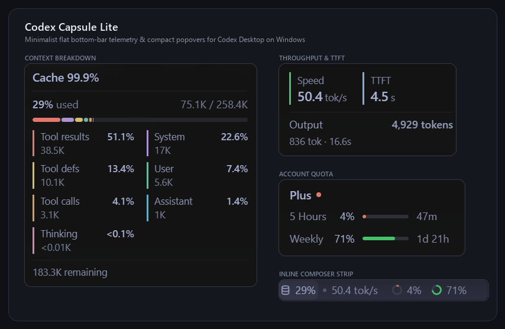

# Codex Capsule Lite

English | [简体中文](README.zh-CN.md)

A minimalist flat-bar UI & reliability fork of [siwangchenfu/Codex-Capsule](https://github.com/siwangchenfu/Codex-Capsule) for the official Windows Codex Desktop app (`ChatGPT.exe`).

It keeps the upstream local telemetry engine (accurate streaming & settled `tok/s` excluding tool wait time, subagent combined throughput, `TTFT`, context composition, and 5h / weekly account quotas) while redesigning the UI into a borderless inline bottom strip with compact English popovers.



## What's Changed in Lite

- **Minimalist Flat Inline Strip**: Removed pill borders and heavy backgrounds. Displays `[db] Context% • tok/s` alongside compact `5h%` and `Weekly%` progress rings cleanly inside the composer footer.
- **Compact Popover Redesign & Full English UI**:
  - **Context**: `Cache` hit rate, `used / max`, a sleek 5px segmented progress bar, aligned 2-column short labels with right-aligned percentages, media count shown only when present, and remaining capacity without verbose tokenizer notes.
  - **Speed & TTFT**: Stripped explanatory paragraphs and large headers, surfacing `Speed`, `TTFT`, `Output`, and turn token/duration stats at a glance.
  - **Account Quota**: Replaced circular rings inside the popover with compact 4-column horizontal progress bars (`5 Hours` / `Weekly`, percentage, pill bar, reset countdown) and a low-quota alert dot (`<= 10%`).
  - **Request Errors**: Localized status badges and failure explanations in English.
- **Launcher & DOM Reliability Fixes**:
  - Added `-WindowStyle Normal` to `Start-Process` calls in `start-codex.ps1` so launching from a hidden shortcut or background watcher never hides `ChatGPT.exe` (`MainWindowHandle = 0`) or locks out re-opening the window.
  - Updated `renderer.js` to target only `[data-composer-footer-responsive]` containers that actually contain `[data-composer-leading-controls]`, preventing missed mounts when the top editor utility toolbar is open.
  - Added `CodexDreamSkin/state.json` loopback CDP discovery fallback in `cdp.mjs`.

## Quick Install (Windows)

**Requirements**: Official Windows Codex Desktop (`OpenAI.Codex`), Node.js 22.13+ (tested on Node.js 24).

**Option 1 — Ask Codex to install it for you**:

> Help me install or update Codex Capsule Lite on this Windows machine from https://github.com/Elosiad/codex-capsule-lite . Check Windows Codex Desktop and Node.js 22.13+, run `.\install.ps1 -FollowCodex`, and verify the inline status strip appears in the composer bar.

**Option 2 — Manual PowerShell install**:

Download or clone this repository, then run in PowerShell from the repo directory:

```powershell
.\install.ps1 -FollowCodex
```

Files are installed to `%LOCALAPPDATA%\CodexCapsule`, launched immediately, and registered in your Windows Startup folder (`Codex Capsule.lnk`).

- Update: pull/download the latest files and run `.\install.ps1` again (preserves your launch mode).
- Manual launch mode (if you prefer not to auto-restart plain Codex launches): run `.\install.ps1 -ManualStart`, then start Codex from the **Codex Capsule** Start Menu shortcut.
- Uninstall:

```powershell
& "$env:LOCALAPPDATA\CodexCapsule\uninstall.ps1"
```

## How It Works & Privacy

- **Local Loopback Only**: The launcher opens Codex with `--remote-debugging-address=127.0.0.1 --remote-debugging-port=0` (or reuses an existing local `Woodfish` / `CodexDreamSkin` loopback endpoint). Any local process under the same Windows user can access that loopback port, and Capsule uses it strictly to inject and update the bottom-bar widget.
- **Read-Only Telemetry**: Reads local SQLite and JSONL logs under `CODEX_HOME` (`~/.codex` by default) to compute token throughput, context composition, and quota windows. **No data is uploaded externally.**
- **Troubleshooting**: Check `%LOCALAPPDATA%\CodexCapsule\status.json` (`active` when attached to a visible window, `waiting` when idle or minimized).

## Verification

```powershell
node --test test.mjs
node --check renderer.js
```

## Upstream & License Note

- Upstream project: [siwangchenfu/Codex-Capsule](https://github.com/siwangchenfu/Codex-Capsule) (the upstream repository does not include a repository-wide `LICENSE` file).
- Bundled tokenizer: `tokenizer.cjs` (`gpt-tokenizer` 4.1.2) includes its original MIT / Unicode license notices.
