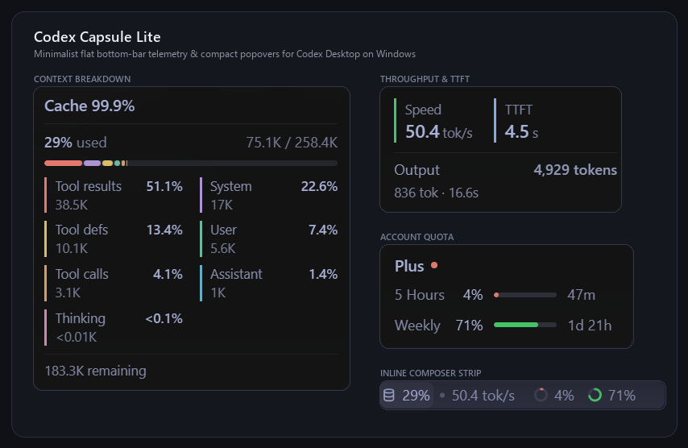

# Codex Capsule Lite

[English](README.md) | 简体中文

基于 [siwangchenfu/Codex-Capsule](https://github.com/siwangchenfu/Codex-Capsule) 的极简扁平外观重构与可靠性修复分支，适用于 Windows 官方 Codex 桌面端（`ChatGPT.exe`）。

完整保留上游纯本地统计内核（剔除工具等待的实时与结算 `tok/s`、子代理合计均速、`TTFT`、上下文构成与 `5h` / 周额度），将界面重构为无边框、无底色填充的极简底栏状态条与紧凑英文明细弹窗。



## 相比原版的改动

- **极简扁平底栏**：去掉圆角胶囊外框与背景填充，以 `[数据库图标] 上下文% • tok/s` 搭配 `5h%`、`Weekly%` 极简双进度环自然嵌入输入框底部工具行。
- **紧凑型详情弹窗 & 全英文 UI**：
  - **上下文（Context）**：展示 `Cache` 命中率、已用/总量、5px 圆角彩色分段条、对齐的 2 列短分类与右对齐百分比；移除冗余的说明文字与零附件占位行，仅在有媒体附件时按需展示。
  - **速率与首响（Speed & TTFT）**：移除大标题与解释长文，精简保留 `Speed`、`TTFT`、`Output` 与当次 token/耗时统计。
  - **账户额度（Account Quota）**：弹窗内将圆环改为 4 列紧凑横向进度条（`5 Hours` / `Weekly`、百分比、圆角横条、重置倒计时），低额度（`<= 10%`）时标题旁显示红点提示。
  - **异常状态（Error）**：底栏报错徽标与详情卡片均提供英文状态映射。
- **启动器与挂载稳定性修复**：
  - 为 `start-codex.ps1` 中的 `Start-Process` 补全 `-WindowStyle Normal`，修复从隐藏快捷方式或后台跟进脚本拉起时 `ChatGPT.exe` 继承隐藏窗口属性导致无窗口驻留、无法重开的问题；
  - 修复 `renderer.js` 在输入框上方展开编辑器工具栏时误选中上方工具栏导致无法挂载的问题（仅匹配含 `[data-composer-leading-controls]` 的底栏）；
  - `cdp.mjs` 新增对 `CodexDreamSkin/state.json` 本地调试端口的回退兼容读取。

## 快速安装（Windows）

**环境要求**：Windows 官方 Codex 桌面端（`OpenAI.Codex`）、Node.js 22.13+（已在 Node.js 24 实测）。

**方式一：让 Codex 帮你安装**

> 请帮我在这台 Windows 电脑上安装或更新 Codex Capsule Lite：https://github.com/Elosiad/codex-capsule-lite 。先检查 Windows 官方 Codex 桌面端和 Node.js 22.13+，在源码目录执行 `.\install.ps1 -FollowCodex`，再打开一个聊天确认输入框底栏能看到极简状态条。

**方式二：手动 PowerShell 安装**

下载或克隆本仓库源码后，在仓库目录打开 PowerShell 执行：

```powershell
.\install.ps1 -FollowCodex
```

安装脚本会将文件部署到 `%LOCALAPPDATA%\CodexCapsule`、立即启动守护进程，并在启动文件夹添加 `Codex Capsule.lnk`。

- **更新**：拉取新版文件后重新执行 `.\install.ps1`（保留原有启动模式）。
- **手动启动模式**：如不希望自动重启普通打开的 Codex，可执行 `.\install.ps1 -ManualStart`，之后从开始菜单的 **Codex Capsule** 快捷方式启动。
- **卸载**：

```powershell
& "$env:LOCALAPPDATA\CodexCapsule\uninstall.ps1"
```

## 运行原理与隐私说明

- **仅限本机回环**：启动器通过 `--remote-debugging-address=127.0.0.1 --remote-debugging-port=0` 开启随机本机回环调试端口（或复用已有的 `Woodfish` / `CodexDreamSkin` 本地回环连接），仅用于注入与刷新输入框状态栏，不向任何外部服务上传数据。
- **纯本地只读采集**：直接读取 `CODEX_HOME`（默认 `~/.codex`）中的本地 SQLite 与 JSONL 日志计算速率、上下文分布和账户额度。
- **状态排查**：查看 `%LOCALAPPDATA%\CodexCapsule\status.json`（前台窗口成功挂载时为 `active`，未打开或窗口最小化/被遮挡时为 `waiting`）。

## 验证

```powershell
node --test test.mjs
node --check renderer.js
```

## 上游致谢与许可说明

- 上游项目：[siwangchenfu/Codex-Capsule](https://github.com/siwangchenfu/Codex-Capsule)（原仓库未单独附带全局 `LICENSE` 文件）。
- 内置分词器 `tokenizer.cjs`（`gpt-tokenizer` 4.1.2）沿用其附带的 MIT / Unicode 许可声明。
